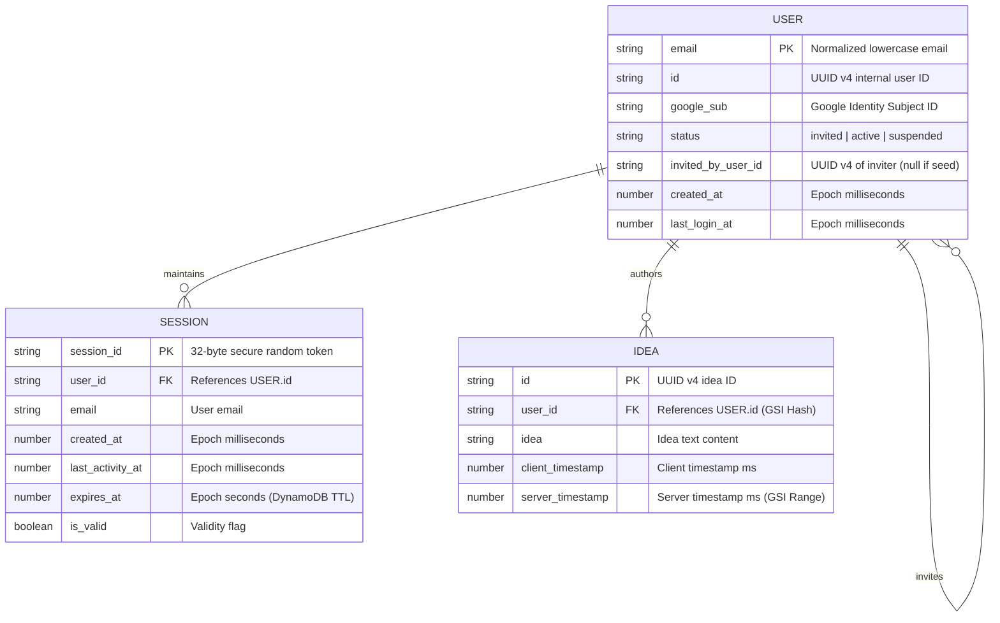
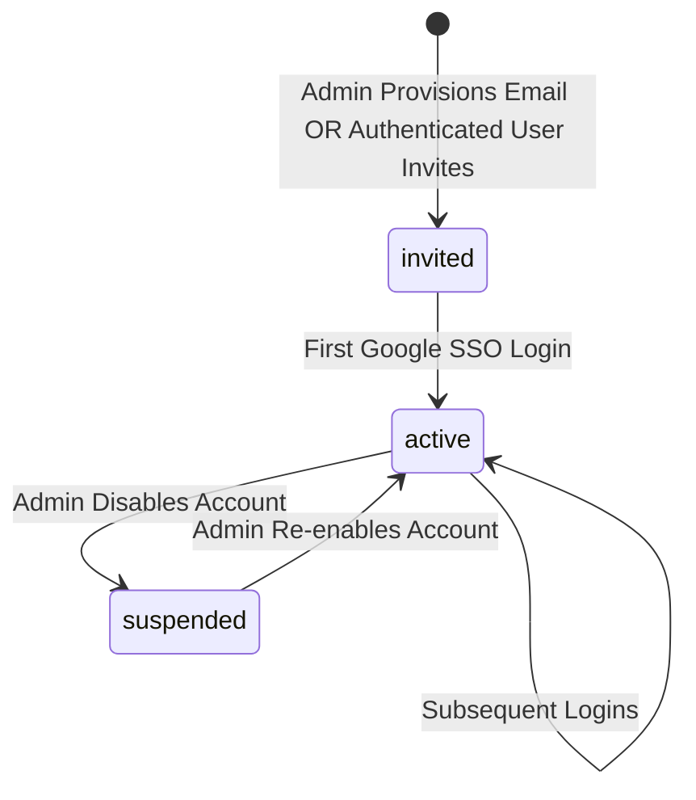
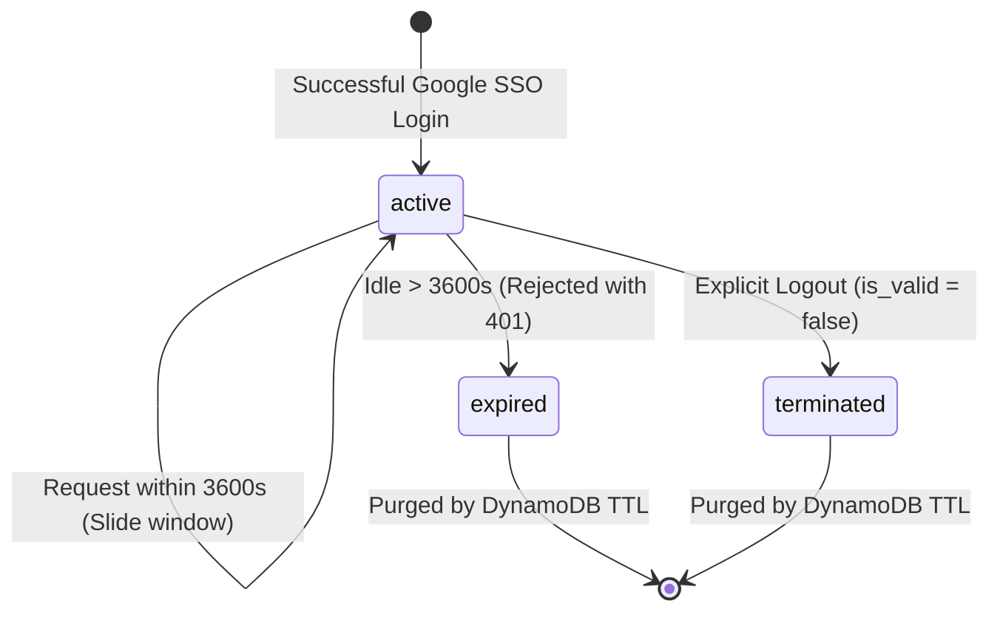

# Data Model: User Authentication and Data Isolation

This document defines the entities, database schemas, relationships, state transitions, and validation rules for User Authentication, Data Isolation, and User Invitations in the Idea Collector application.

## Entities Overview

---

## 1. DynamoDB Table: `IdeaCollector_Users`

Stores invited and provisioned user accounts. Serves as the authoritative registry for invite-only access control.

### Schema
- **Partition Key**: `email` (String) - Normalized lowercase email address.
- **Sort Key**: None

### Attributes

| Attribute Name | Type | Required | Constraints / Description |
|----------------|------|----------|---------------------------|
| `email` | String | Yes | Primary Key. Lowercase, valid RFC 5322 email format. |
| `id` | String | Yes | Unique UUID v4 assigned during provisioning or invitation. |
| `google_sub` | String | No | Federated subject ID (`sub`) from Google OIDC; linked on first sign-in. |
| `status` | String | Yes | Enum: `"invited"`, `"active"`, `"suspended"`. |
| `invited_by_user_id` | String | No | UUID v4 of the user who issued the invitation (null for initial admin seeds). |
| `created_at` | Number | Yes | Epoch milliseconds when the user was invited/provisioned. |
| `last_login_at` | Number | No | Epoch milliseconds of the most recent successful authentication. |

### State Transitions

---

## 2. DynamoDB Table: `IdeaCollector_Sessions`

Tracks active user sessions, enforcing the 1-hour idle timeout and immediate invalidation on logout.

### Schema
- **Partition Key**: `session_id` (String) - High-entropy cryptographically generated random token (32 bytes base64url).
- **Sort Key**: None
- **TTL Attribute**: `expires_at` (Number - Epoch seconds). DynamoDB automatically purges expired records.

### Attributes

| Attribute Name | Type | Required | Constraints / Description |
|----------------|------|----------|---------------------------|
| `session_id` | String | Yes | Primary Key. Bearer token provided to client. |
| `user_id` | String | Yes | References `IdeaCollector_Users.id`. |
| `email` | String | Yes | Email of the authenticated user. |
| `created_at` | Number | Yes | Epoch milliseconds when session was issued. |
| `last_activity_at` | Number | Yes | Epoch milliseconds of last request; checked for 1-hour idle timeout. |
| `expires_at` | Number | Yes | Epoch seconds (`last_activity_at + 3600`), used by DynamoDB TTL. |
| `is_valid` | Boolean | Yes | `true` if active; set to `false` upon explicit logout or revocation. |

### State Transitions

---

## 3. DynamoDB Table: `IdeaCollector_Ideas`

Stores submitted ideas, strictly isolated by user.

### Primary Schema
- **Partition Key**: `id` (String) - UUID v4 uniquely identifying the idea.
- **Sort Key**: None

### Global Secondary Index: `UserIdeasIndex`
- **Partition Key**: `user_id` (String) - The owning user's identifier.
- **Sort Key**: `server_timestamp` (Number) - Server ingestion timestamp (epoch milliseconds).
- **Projection**: `ALL`

### Attributes

| Attribute Name | Type | Required | Constraints / Description |
|----------------|------|----------|---------------------------|
| `id` | String | Yes | Primary Key. UUID v4. |
| `user_id` | String | Yes | Owning user identifier (`IdeaCollector_Users.id`). Sparse for legacy records. |
| `idea` | String | Yes | 1 to 5,000 characters. Trimmed whitespace cannot be empty. |
| `client_timestamp` | Number | Yes | Epoch milliseconds provided by frontend client. |
| `server_timestamp` | Number | Yes | Epoch milliseconds stamped by ingestion Lambda upon persistence. |

### State Transitions
- **Append-Only**: Ideas are immutable once created. Editing and deletion are deferred to future iterations.

---

## Validation Rules & Access Controls

1. **Invite-Only Enforcement (FR-001, FR-003)**:
   - Upon receiving a Google ID token, backend extracts the verified `email`.
   - Table `IdeaCollector_Users` must contain an item matching the email.
   - If not found: Reject with HTTP `403 Forbidden` (`ACCOUNT_NOT_INVITED`).
   - If `status == "suspended"`: Reject with HTTP `403 Forbidden` (`ACCOUNT_SUSPENDED`).

2. **User Invitation Validation (FR-014, FR-015)**:
   - Creating invitations (`POST /api/invitations`) requires active session.
   - Recipient `email` must be a valid email format.
   - Self-invitation check: `recipient_email != session.email`.
   - Duplicate check: If `recipient_email` is already present in `IdeaCollector_Users`, reject with HTTP `409 Conflict` (`USER_ALREADY_EXISTS`).
   - Record created with `id = uuid()`, `status = "invited"`, `invited_by_user_id = session.user_id`.

3. **Session Validity & Idle Timeout (FR-006, FR-011)**:
   - Protected endpoints require `Authorization: Bearer <session_id>`.
   - Session must exist in `IdeaCollector_Sessions` and `is_valid == true`.
   - `(current_epoch_ms - last_activity_at) <= 3600000` (1 hour idle timeout).
   - If exceeded: Reject with HTTP `401 Unauthorized` (`SESSION_EXPIRED`).
   - If valid: Slide session window (`last_activity_at = current_epoch_ms`, `expires_at = (current_epoch_ms / 1000) + 3600`).

4. **User Isolation & Retrieval (FR-007, FR-008, FR-009, FR-010)**:
   - Creating ideas (`POST /api/ideas`): `user_id` is stamped directly from the authenticated session context. Untrusted client payloads cannot set or override `user_id`.
   - Listing ideas (`GET /api/ideas`): Backend executes DynamoDB `Query` against `UserIdeasIndex` where `user_id = session.user_id` and `ScanIndexForward = false`. Data from other users cannot be returned.
   - Legacy records without a `user_id` are absent from `UserIdeasIndex` (sparse index), guaranteeing zero legacy data leakage.

5. **Idea Content Validation (Edge Cases)**:
   - `idea` text length: 1 to 5,000 characters after trimming leading/trailing whitespace.
   - Whitespace-only submissions rejected with HTTP `400 Bad Request`.
