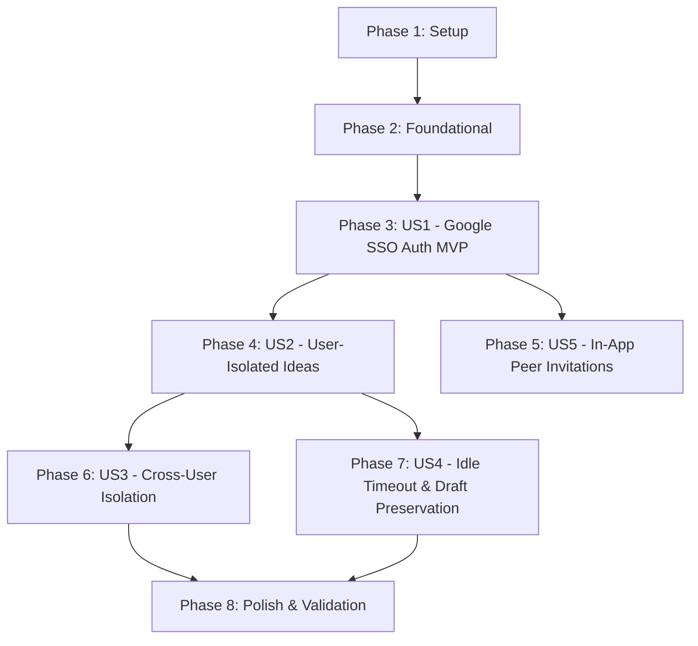

# Tasks: User Authentication, Data Isolation & Invitations

**Input**: Design documents from `/specs/002-auth-data-isolation/` (`spec.md`, `plan.md`, `research.md`, `data-model.md`, `contracts/api.yml`, `quickstart.md`)

**Prerequisites**: plan.md (required), spec.md (required for user stories), research.md, data-model.md, contracts/api.yml

**Organization**: Tasks are grouped by user story to enable independent implementation and testing of each story.

## Format: `[ID] [P?] [Story] Description`

- **[P]**: Can run in parallel (different files, no dependencies)
- **[Story]**: Which user story this task belongs to (e.g., US1, US2, US3, US4, US5)
- Include exact file paths in descriptions

---

## Phase 1: Setup (Shared Infrastructure)

**Purpose**: Infrastructure provisioning, shared dependencies, and project configuration

- [x] T001 [P] Provision DynamoDB tables `IdeaCollector_Users` (PK: `email` String), `IdeaCollector_Sessions` (PK: `session_id` String, TTL attribute: `expires_at`), and add GSI `UserIdeasIndex` (PK: `user_id` String, SK: `server_timestamp` Number, Projection: `ALL`) to `IdeaCollector_Ideas` in `apps/idea-collector/infra/main.tf`
- [x] T002 [P] Update Lambda IAM execution role and DynamoDB access policies in `apps/idea-collector/infra/main.tf` to grant CRUD permissions for `IdeaCollector_Users`, `IdeaCollector_Sessions`, and query access on `UserIdeasIndex`
- [x] T003 [P] Add API Gateway HTTP routes for `POST /api/auth/google`, `GET /api/auth/me`, `POST /api/auth/logout`, `GET /api/ideas`, and `POST /api/invitations` in `apps/idea-collector/infra/main.tf`
- [x] T004 [P] Update Go dependencies in `apps/idea-collector/backend/go.mod` with AWS SDK v2 DynamoDB attributevalue packages and Google ID token verification support
- [x] T005 [P] Configure frontend dependencies and Google Identity Services SDK type definitions in `apps/idea-collector/frontend/package.json` and `apps/idea-collector/frontend/src/vite-env.d.ts`

---

## Phase 2: Foundational (Blocking Prerequisites)

**Purpose**: Core data models, database repositories, auth verification, and session management required by all user stories

**⚠️ CRITICAL**: No user story work can begin until this phase is complete

- [x] T006 [P] Define User, Session, Idea, and Invitation domain models and DTOs with validation constraints verbatim from `data-model.md` (`idea` 1–5,000 characters, RFC 5322 email, 1-hour session idle timeout: `(current_epoch_ms - last_activity_at) <= 3600000`) in `apps/idea-collector/backend/models/models.go`
- [x] T007 [P] Implement DynamoDB repository layer for `IdeaCollector_Users`, `IdeaCollector_Sessions`, and `IdeaCollector_Ideas` (including `UserIdeasIndex` query helpers) in `apps/idea-collector/backend/repository/dynamo.go`
- [x] T008 [P] Implement Google ID token verification against Google public JWKS (`https://www.googleapis.com/oauth2/v3/certs`) with in-memory key caching in `apps/idea-collector/backend/auth/google.go`
- [x] T009 Implement session manager generating 32-byte secure random tokens (`crypto/rand`), managing session lifecycle in DynamoDB, and enforcing sliding 1-hour idle timeout in `apps/idea-collector/backend/auth/session.go`
- [x] T010 Implement centralized API router and middleware to extract and validate session context from `Authorization: Bearer <session_id>` header in `apps/idea-collector/backend/main.go`
- [x] T011 [P] Implement typed API client with Bearer token header injection and unified error handling in `apps/idea-collector/frontend/src/services/api.ts`

**Checkpoint**: Foundation ready - user story implementation can now begin in parallel

---

## Phase 3: User Story 1 - Federated Sign-In via Google SSO for Invited Users (Priority: P1) 🎯 MVP

**Goal**: Authenticate invited users via Google SSO, establish a 1-hour session, deny uninvited users with 403 Forbidden, and support explicit logout.

**Independent Test**: Sign in with an authorized Google account, verify session creation and workspace entry; attempt sign in with an uninvited account and verify 403 Forbidden notice; click logout and verify session termination.

### Implementation for User Story 1

- [x] T012 [P] [US1] Implement `POST /api/auth/google` handler validating Google ID token, checking email in `IdeaCollector_Users`, transitioning status from `invited` to `active`, and issuing an active session in `apps/idea-collector/backend/handlers/auth.go`
- [x] T013 [P] [US1] Implement `GET /api/auth/me` and `POST /api/auth/logout` handlers in `apps/idea-collector/backend/handlers/auth.go`
- [x] T014 [P] [US1] Implement `AuthPrompt` component rendering Google Sign-In button via Google Identity Services and displaying an unauthorized error notice for uninvited accounts in `apps/idea-collector/frontend/src/components/AuthPrompt.tsx`
- [x] T015 [P] [US1] Implement `useAuth` hook managing user authentication state, session token storage, and login/logout methods in `apps/idea-collector/frontend/src/hooks/useAuth.ts`
- [x] T016 [US1] Implement application `Header` component displaying logged-in user email and a Logout button in `apps/idea-collector/frontend/src/components/Header.tsx`
- [x] T017 [US1] Integrate `AuthPrompt`, `Header`, and protected workspace routing guard in `apps/idea-collector/frontend/src/App.tsx`

**Checkpoint**: At this point, User Story 1 is fully functional and testable independently as an MVP.

---

## Phase 4: User Story 2 - User-Isolated Idea Management (Priority: P1)

**Goal**: Authenticated users can submit ideas linked strictly to their user ID and view their personal ideas in reverse chronological order, with an empty state for new users.

**Independent Test**: Log in as User A, submit ideas, verify ideas are persisted with User A's ID and rendered newest first in the list; log in as a fresh user and verify empty state prompt is displayed.

### Implementation for User Story 2

- [x] T018 [P] [US2] Update `POST /api/ideas` handler to associate submitted ideas with `user_id` extracted from validated session context in `apps/idea-collector/backend/handlers/ideas.go`
- [x] T019 [P] [US2] Implement `GET /api/ideas` handler executing DynamoDB Query on `UserIdeasIndex` with `user_id = session.user_id` and `ScanIndexForward = false` in `apps/idea-collector/backend/handlers/ideas.go`
- [x] T020 [P] [US2] Implement `IdeaForm` component with submission loading state, input trimming, and 5,000 character validation in `apps/idea-collector/frontend/src/components/IdeaForm.tsx`
- [x] T021 [P] [US2] Implement `IdeaList` component rendering submitted ideas ordered reverse-chronologically and an `EmptyState` view when no ideas exist in `apps/idea-collector/frontend/src/components/IdeaList.tsx`
- [x] T022 [US2] Implement `useIdeas` hook managing idea fetching and optimistic or immediate submission updates in `apps/idea-collector/frontend/src/hooks/useIdeas.ts`
- [x] T023 [US2] Integrate `IdeaForm` and `IdeaList` into the authenticated workspace view in `apps/idea-collector/frontend/src/App.tsx`

**Checkpoint**: User Story 1 and User Story 2 work together seamlessly; users can authenticate and manage their own ideas.

---

## Phase 5: User Story 5 - Authenticated User Invites New Users (Priority: P2)

**Goal**: Any authenticated user can invite new users by entering their Google email address from the frontend workspace; system validates email, rejects duplicates and self-invitations, and links `invited_by_user_id`.

**Independent Test**: Log in as User A, submit an invitation for User B (`bob@example.com`); verify confirmation; authenticate as User B via Google SSO and confirm immediate workspace access; attempt duplicate invitation and verify 409 notice.

### Implementation for User Story 5

- [x] T024 [P] [US5] Implement `POST /api/invitations` handler validating recipient email format, preventing self-invitation (`email != session.email`), checking for duplicates in `IdeaCollector_Users` (returning 409 Conflict), and creating invited user record with `invited_by_user_id = session.user_id` in `apps/idea-collector/backend/handlers/invitations.go`
- [x] T025 [P] [US5] Implement `InviteForm` component with email input, loading indicator, success message, and duplicate notice handling in `apps/idea-collector/frontend/src/components/InviteForm.tsx`
- [x] T026 [US5] Implement `useInvitations` hook to execute invitation API calls and manage status feedback in `apps/idea-collector/frontend/src/hooks/useInvitations.ts`
- [x] T027 [US5] Integrate `InviteForm` into the authenticated workspace header or navigation in `apps/idea-collector/frontend/src/App.tsx`

**Checkpoint**: Authenticated users can now onboard new peers directly through the web UI without manual database interventions.

---

## Phase 6: User Story 3 - Cross-User Data Access Prevention (Priority: P2)

**Goal**: Prevent any cross-user data leakage, ensure direct object reference probes for another user's idea return access denied / not found with zero metadata leakage, and immediately block disabled/suspended accounts.

**Independent Test**: Create ideas under User A; log in as User B and verify 0 ideas from User A appear; attempt direct lookup of User A's idea ID by User B and verify 404 response without metadata; disable User A in database and verify immediate rejection on subsequent requests.

### Implementation for User Story 3

- [x] T028 [P] [US3] Enforce strict ownership validation on all idea operations and mask existence on unauthorized probes (return 404 without leaking metadata) in `apps/idea-collector/backend/handlers/ideas.go`
- [x] T029 [P] [US3] Add account status check (`status == "suspended"`) in session verification middleware to immediately reject suspended accounts with 403 Forbidden in `apps/idea-collector/backend/auth/session.go`
- [x] T030 [US3] Implement unit/integration tests verifying cross-tenant isolation and probe masking in `apps/idea-collector/backend/handlers/ideas_test.go`

**Checkpoint**: Security and multi-tenant isolation guarantees are fully verified and covered by automated tests.

---

## Phase 7: User Story 4 - Session Expiration and Re-Authentication (Priority: P3)

**Goal**: Enforce 1-hour idle timeout, detect session expiration on the client, preserve unsubmitted idea text in `localStorage`, prompt user to re-authenticate via Google SSO, and restore state without data loss.

**Independent Test**: Simulate session expiration (>1 hour idle); attempt an action; verify 401 Unauthorized (`SESSION_EXPIRED`); verify unsubmitted text in idea form remains intact; complete Google SSO sign-in; verify idea text is preserved and can be submitted immediately.

### Implementation for User Story 4

- [x] T031 [P] [US4] Implement `useDraft` hook syncing in-progress idea text to `localStorage` under `ideacollector_draft_content` and clearing it only upon successful submission in `apps/idea-collector/frontend/src/hooks/useDraft.ts`
- [x] T032 [P] [US4] Add HTTP 401 error interceptor in `apps/idea-collector/frontend/src/services/api.ts` to trigger expired session state in `useAuth`
- [x] T033 [US4] Implement `SessionExpiredModal` component prompting for re-authentication via Google SSO while keeping form draft content intact in `apps/idea-collector/frontend/src/components/SessionExpiredModal.tsx`
- [x] T034 [US4] Connect `useDraft` and `SessionExpiredModal` to `IdeaForm` and main application flow in `apps/idea-collector/frontend/src/App.tsx`

**Checkpoint**: Session lifecycle is completely resilient with zero data loss during idle timeouts.

---

## Phase 8: Polish & Cross-Cutting Concerns

**Purpose**: UI polishing, end-to-end validation, build verification, and quality checks

- [x] T035 [P] Implement responsive CSS styling, glassmorphism card surfaces, and accessible focus states across all components in `apps/idea-collector/frontend/src/App.css`
- [x] T036 Run Go linting and tests (`go vet ./...` and `go test ./...`) in `apps/idea-collector/backend/`
- [x] T037 Run frontend typechecking and build (`pnpm nx run idea-collector-frontend:build`) in `apps/idea-collector/frontend/`
- [x] T038 Validate Terraform configuration formatting and validation in `apps/idea-collector/infra/`
- [x] T039 Execute and verify end-to-end validation scenarios 1 through 8 from `specs/002-auth-data-isolation/quickstart.md`

---

## Dependencies & Execution Order

### Phase Dependencies



- **Setup (Phase 1)**: No dependencies - can start immediately.
- **Foundational (Phase 2)**: Depends on Phase 1 completion - **BLOCKS all user stories**.
- **User Stories (Phase 3+)**:
  - **US1 (Phase 3)**: Foundational dependency. Provides the authentication boundary needed for all subsequent features.
  - **US2 (Phase 4)**: Depends on US1 (requires authenticated session context).
  - **US5 (Phase 5)**: Depends on US1 (invitations require authenticated session). Can run in parallel with US2.
  - **US3 (Phase 6)**: Depends on US2 (tests isolation of submitted ideas).
  - **US4 (Phase 7)**: Depends on US2 (extends IdeaForm with draft preservation).
- **Polish (Phase 8)**: Depends on all user story implementations being completed.

---

## Parallel Execution Examples

### Parallel Example: Foundational Phase
```bash
# Launch model definitions, JWKS auth verification, and frontend client concurrently:
Task: "Define User, Session, Idea, and Invitation models in apps/idea-collector/backend/models/models.go"
Task: "Implement Google ID token verification in apps/idea-collector/backend/auth/google.go"
Task: "Implement typed API client in apps/idea-collector/frontend/src/services/api.ts"
```

### Parallel Example: User Story 1
```bash
# Launch backend handler and frontend components in parallel:
Task: "Implement POST /api/auth/google handler in apps/idea-collector/backend/handlers/auth.go"
Task: "Implement AuthPrompt component in apps/idea-collector/frontend/src/components/AuthPrompt.tsx"
Task: "Implement useAuth hook in apps/idea-collector/frontend/src/hooks/useAuth.ts"
```

### Parallel Example: User Story 2
```bash
# Launch backend ingestion and frontend UI in parallel:
Task: "Update POST /api/ideas handler in apps/idea-collector/backend/handlers/ideas.go"
Task: "Implement GET /api/ideas handler in apps/idea-collector/backend/handlers/ideas.go"
Task: "Implement IdeaForm component in apps/idea-collector/frontend/src/components/IdeaForm.tsx"
Task: "Implement IdeaList component in apps/idea-collector/frontend/src/components/IdeaList.tsx"
```

---

## Implementation Strategy

### MVP First (User Story 1 Only)
1. Complete Phase 1 (Setup) and Phase 2 (Foundational).
2. Complete Phase 3 (User Story 1 - Google SSO Sign-In & Logout).
3. **STOP and VALIDATE**: Verify invited users can sign in and uninvited users are rejected via Scenario 2 and Scenario 3 of `quickstart.md`.

### Incremental Delivery
1. **Increment 1 (MVP)**: Setup + Foundation + US1 (Google SSO authentication working end-to-end).
2. **Increment 2**: US2 (Authenticated users submit and list their isolated ideas).
3. **Increment 3**: US5 (In-app peer invitations allowing users to onboard collaborators).
4. **Increment 4**: US3 & US4 (Cross-user access denial tests, 1-hour idle timeout, and draft text preservation).
5. **Increment 5**: Polish, typecheck, build verification, and full quickstart validation.
