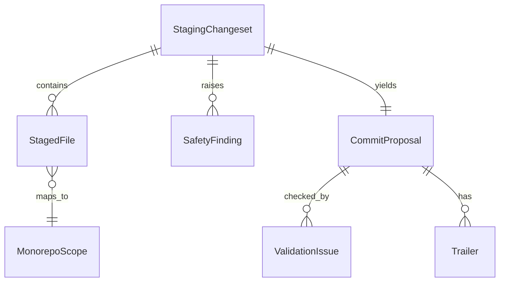

# Data Model: Standardize Commits Skill

**Feature**: `003-standardize-commits` | **Date**: 2026-10-18

There is no persistent storage. These are the in-memory entities the CLI computes and the JSON it emits (see [contracts/cli-schema.yml](contracts/cli-schema.yml)).

## Entity Relationship Overview



## StagingChangeset

The set of changes currently in the git index.

| Field | Type | Notes |
| :--- | :--- | :--- |
| `branch` | string | Current branch; commit is refused on `main`/`master` |
| `files` | StagedFile[] | One per added/modified/deleted/renamed path |
| `staged_count` | int | `0` triggers the "nothing staged" guidance (US1 scenario 3) |
| `unstaged_count` | int | Reported only; never modified |
| `git_state` | enum | `normal` / `merge` / `rebase` / `cherry-pick` |
| `lockfile_only` | bool | Drives the dependency-update classification |

## StagedFile

| Field | Type | Notes |
| :--- | :--- | :--- |
| `path` | string | Repository-relative |
| `status` | enum | `A` / `M` / `D` / `R` |
| `scope` | string | Result of the scope map; see MonorepoScope |
| `category` | enum | `source` / `test` / `docs` / `ci` / `build` / `config` / `lockfile` / `other` |

## MonorepoScope

| Value | Matches |
| :--- | :--- |
| `<app-name>` (`idea-collector`, `commifra`, ...) | `apps/<app-name>/**` |
| `ci` | `.github/**` |
| `infra` | top-level `infra/**` |
| `shared` | `packages/**`, `shared/**` |
| `scripts` | `scripts/**` |
| `repo` | everything else (root files, `docs/`, `.claude/`, `.agents/`, `.specify/`, `specs/`) |

`deps` is also a valid scope, used only for lockfile/manifest-only changesets (`build(deps)`). Scope is optional in the header. Rules and the companion-file exceptions are in [contracts/scope-and-type-rules.md](contracts/scope-and-type-rules.md).

## CommitProposal

| Field | Type | Rules |
| :--- | :--- | :--- |
| `type` | enum \| null | One of `feat fix chore docs style refactor perf test build ci req infra`; `null` when ambiguous |
| `type_candidates` | string[] | Ranked heuristic guesses, shown when `type` is null |
| `scope` | string \| null | Single scope, or null for global chores |
| `breaking` | bool | `true` adds `!` and requires `breaking_note` |
| `breaking_note` | string \| null | Becomes the `BREAKING CHANGE:` footer |
| `summary` | string | Imperative, lowercase first letter, no trailing period; header < 100 chars |
| `body` | string \| null | Optional; separated from the header by one blank line |
| `trailers` | Trailer[] | Footers such as `Co-Authored-By` |
| `header` | string | Derived: `type(scope)!: summary`; the `(scope)` part is omitted when scope is null or equals the type |
| `message` | string | Derived full message that `commit` re-validates |
| `warnings` | string[] | `multi-scope`, `unstaged-present`, `merge-in-progress`, `large-changeset` (breaking-change hints are not warnings; they are the separate `breaking_hints` field) |

**State transitions**

```text
proposed --(contributor edits)--> proposed (re-validated)
proposed --(validation fails)---> rejected  (issues listed, nothing committed)
proposed --(confirm)-----------> committed  (hash returned)
proposed --(cancel)------------> cancelled  (index untouched)
```

## ValidationIssue

| Field | Type | Notes |
| :--- | :--- | :--- |
| `rule` | string | e.g. `type-invalid`, `header-too-long`, `trailing-period`, `not-imperative`, `uppercase-summary`, `missing-blank-line`, `breaking-footer-missing`, `empty-message` |
| `severity` | enum | `error` blocks `commit` and makes `validate` exit `1`; `warning` is reported but never blocks. Only `not-imperative` is a warning (its heuristic can misjudge a legitimate summary); every other rule is an error |
| `detail` | string | What is wrong |
| `suggestion` | string | A compliant replacement where one can be computed |

## SafetyFinding

| Field | Type | Notes |
| :--- | :--- | :--- |
| `kind` | enum | `sensitive-path` / `secret-pattern` |
| `path` | string | The staged file |
| `rule` | string | Pattern name; the matched secret text is never emitted |
| `overridable` | bool | `true` only for `sensitive-path` via `--allow-sensitive <path>` |
| `allowed` | bool | `true` when this finding was cleared by `--allow-sensitive`; allowed findings are still listed but do not block |

## Trailer

`Token: value` (token is `[A-Za-z-]+`, or `BREAKING CHANGE`). Rendered after a blank line at the end of the message.
