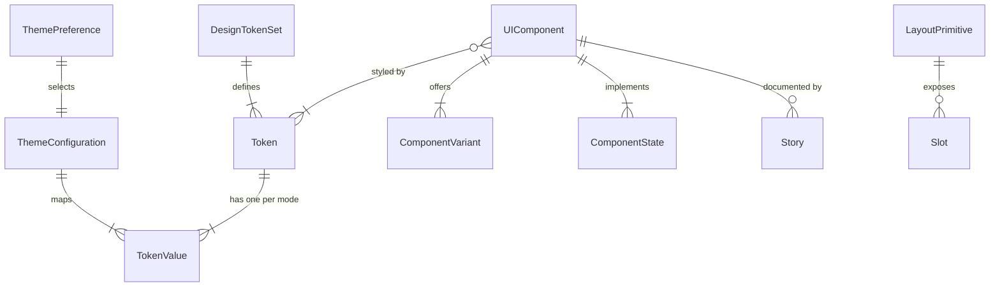

# Data Model: Consistent Design System and Shared UI Library

**Feature**: `004-design-system` | **Date**: 2026-10-19

There is no server-side data. These are the design-time entities from the spec, made concrete, plus the one piece of persisted state (the theme choice). Interfaces are in [contracts/](contracts/).

## Entity Relationship Overview



## DesignTokenSet

The complete set of named design constants. Source of truth: `packages/ui/src/tokens/tokens.ts`; applied by `packages/ui/src/styles/theme.css`.

| Field | Type | Rules |
| :--- | :--- | :--- |
| `name` | string | Semantic, unprefixed shadcn names (`background`, `primary`, `destructive`, ...) |
| `group` | enum | `surface`, `text`, `accent`, `status`, `control`, `radius` |
| `light` / `dark` | oklch string | Both modes are required for every color token |
| `pairs` | list | Foreground/background pairs that must pass contrast (see below) |

Rules:
- Every color token has a value for both modes; a missing mode fails the contrast test.
- Status families `success`, `warning`, `info` and the existing `destructive` each define a base and a `-foreground`.
- `radius` is a single base (`0.625rem`) from which small, medium and large radii derive.
- Typography, spacing and shadow tokens are the Tailwind CSS theme variables (`--text-*`, `--font-*`, `--spacing`, `--shadow-*`), shared through the same preset and not redefined; semantic names apply to colors and radii. Typography is the system font stack and the Tailwind type scale; spacing is the Tailwind spacing scale.

### ContrastPair

| Field | Type | Rules |
| :--- | :--- | :--- |
| `foreground` / `background` | token names | Both resolved per mode |
| `kind` | enum | `text` (needs 4.5:1), `large-text` (3:1), `control` (3:1, for boundaries, focus rings and icons) |
| `mode` | enum | Evaluated in `light` and in `dark` |

## ThemeConfiguration

The semantic mapping of tokens to concrete values for each mode.

| Field | Type | Rules |
| :--- | :--- | :--- |
| `mode` | enum | `light` or `dark` |
| `selector` | string | `:root` for light, `.dark` for dark |
| `values` | map token to oklch | Complete for the mode |

## ThemePreference (persisted)

| Field | Type | Rules |
| :--- | :--- | :--- |
| `storageKey` | string | `ui-theme` in `localStorage` |
| `value` | enum | `light`, `dark` or `system` |
| `default` | enum | `system` when nothing is stored or storage is unavailable |
| `resolved` | enum | `light` or `dark`: the stored value, or the OS setting when `system` |

**State transitions**

```text
system --(user picks light)--> light
system --(user picks dark)---> dark
light/dark --(user picks system)--> system
system --(OS preference changes)--> system (resolved flips, no write)
any --(storage unavailable)--> keeps working in memory, falls back to system on reload
```

## UIComponent

First-release set (FR-014): Button, Text Input, Textarea, Card, Dialog, Alert, Select, Checkbox, Radio, Tooltip, Spinner, Badge.

| Field | Type | Rules |
| :--- | :--- | :--- |
| `name` | string | One file per component in `packages/ui/src/components/` |
| `foundation` | enum | `radix` (Dialog, Select, Checkbox, Radio, Tooltip), `native` (the rest) |
| `variants` | list | Defined per component in the API contract |
| `states` | list | See the state matrix |
| `a11y` | rules | Role, label, keyboard and focus behavior per component |
| `stories` | list | At least one story per variant, each in both themes |

### ComponentState matrix

| State | Applies to | Visual rule |
| :--- | :--- | :--- |
| default | all | Base tokens |
| hover | Button, Select trigger, Checkbox, Radio, Card (if interactive) | Slight surface or opacity change, still AA |
| focus | all interactive | Visible focus ring using `--ring` (3:1) |
| active / pressed | Button, Checkbox, Radio | Pressed surface |
| disabled | all interactive | Reduced emphasis, not focusable, `aria-disabled` where it stays in the tab order |
| error / invalid | Text Input, Textarea, Select, Checkbox, Radio | `destructive` border and message; `aria-invalid` and a described-by message |

### ComponentVariant

| Component | Variants and sizes |
| :--- | :--- |
| Button | `default`, `secondary`, `outline`, `ghost`, `destructive`, `link`; sizes `sm`, `default`, `lg`, `icon` |
| Alert | `default`, `destructive`, `success`, `warning`, `info` |
| Badge | `default`, `secondary`, `outline`, `destructive` |
| Spinner | sizes `sm`, `default`, `lg`; always `role="status"` with a hidden text label |
| Card | composed of Header, Title, Description, Content, Footer |
| Dialog | `dismissible` true (default) or false; composed of Header, Title, Description, Footer |
| Others | A single default variant |

## LayoutPrimitive

| Name | Purpose | Slots | Responsive rule |
| :--- | :--- | :--- | :--- |
| `PageContainer` | Constrains width and padding | children | Fluid below 640px; centered max width at and above 1024px |
| `AppHeader` | Application top bar | `brand`, `actions` | Actions stack or collapse below 640px without overflow |
| `SidebarLayout` | Sidebar plus content | `sidebar`, `children` | Sidebar stacks above content below 1024px |

## Migration mapping (idea-collector, FR-013)

| Current element | Becomes | Notes |
| :--- | :--- | :--- |
| `.app-container` wrapper in `App.tsx` | `PageContainer` | Loading, signed-out and workspace views |
| `Header.tsx` | `AppHeader` + `Badge` + `Button` (outline, sm) | Lightbulb and User icons from Lucide, decorative |
| `AuthPrompt.tsx` | `Card` + `Alert` (destructive) + `Spinner` + `Button` + `GoogleIcon` | Keeps `role="alert"` for the error and the existing `aria-label` |
| `IdeaForm.tsx` | `Card` + `Textarea` + `Alert` (destructive and success) + `Button` | Keeps `role="alert"` and `role="status"`, the 5000-character rule and the disabled logic |
| `IdeaList.tsx` | `Card` + `Badge` + `Spinner` | Loading, empty and populated states; count badge |
| `SessionExpiredModal.tsx` | `Dialog` (`dismissible={false}`) + `Alert` + `Button` + `GoogleIcon` | Non-dismissible, same copy, focus on the sign-in button |
| `.spinner` (3 uses) | `Spinner` | |
| `App.css` (636 lines) | deleted | After legacy variables are prefixed and all screens are migrated |

## Validation rules (from the requirements)

- FR-003: every interactive component implements all six states in its story set.
- FR-004: `ThemePreference.default` is `system`; an explicit choice overrides it.
- FR-005: every `ContrastPair` passes in both modes.
- FR-006: every interactive component has a keyboard `play` test.
- FR-007 and SC-004: layout stories show no horizontal overflow from 320px to 2560px.
- FR-009: `theme.css` contains no element selectors and no base reset, and a browser test shows plain unstyled HTML keeps identical computed styles when `theme.css` is added.
- FR-013: the characterization tests pass unchanged before and after the migration.
