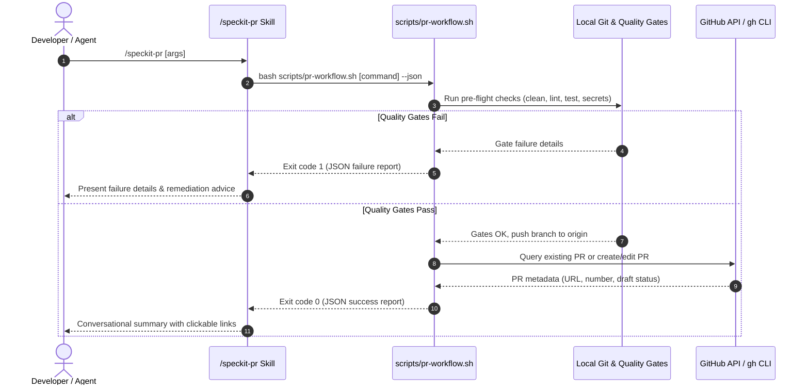

# Skill Contract: `/speckit-pr`

**Feature**: `007-manage-pr-workflow`
**File Path**: `.agents/skills/speckit-pr/SKILL.md`

## Overview

The `/speckit-pr` skill provides an interactive, conversational slash command companion for developers and AI pairing agents to manage post-implementation Pull Request workflows on GitHub.

---

## Invocation Syntax

```text
/speckit-pr [OPTIONS]
```

### Supported Arguments & Flags

| Flag | Purpose | Default Behavior |
| :--- | :--- | :--- |
| *(no arguments)* | Auto-detect: if no PR exists for current branch, runs `--create --draft`; if PR exists, runs `--update` | Context-aware default |
| `--create`, `create`, `create-mr` | Explicitly creates a new Pull Request | Opens as Draft unless `--ready` is passed |
| `--update`, `update`, `update-mr` | Explicitly refreshes the existing Pull Request's body and task checklist | Preserves reviewer comments |
| `--status`, `status`, `checks` | Queries GitHub Actions CI workflow run status and merge readiness | Outputs clean status table |
| `--check`, `check` | Runs pre-flight verification gates only (no remote git or GitHub mutations) | Reports pass/fail for each gate |
| `--ready`, `--publish` | Creates or transitions the PR to Ready for Review | Non-draft PR |
| `--draft` | Ensures PR is created or maintained as Draft | Draft PR |
| `--base <branch>` | Overrides base integration branch (e.g., `--base release/v1.0`) | Defaults to `main` |

---

## Execution Flow



---

## Conversational Output Expectations

### 1. Successful PR Creation Response
```markdown
### 🚀 Pull Request Created (Draft)

- **PR**: [#42: feat(pr): implement post-implementation PR workflow](https://github.com/dinhlockt02/myspace/pull/42)
- **Branch**: `007-manage-pr-workflow` → `main`
- **State**: Draft (Review locally before publishing)
- **Affected Projects**: `scripts`, `.agents/skills/speckit-pr`
- **Pre-Flight Gates**: All passed (git clean, lint, test, secret scan)

To update this PR after making further changes, run `/speckit-pr --update`.
To mark it ready for team review, run `/speckit-pr --ready`.
```

### 2. Pre-Flight Failure Response
```markdown
### ⚠️ Pre-Flight Check Failed

The Pull Request workflow was blocked because quality gates failed:
- **Lint**: ❌ `idea-collector-frontend:lint` reported 2 errors
- **Tests**: ✅ Passed
- **Secrets Scan**: ✅ Clear

Please resolve the issues above and re-run `/speckit-pr`.
```
