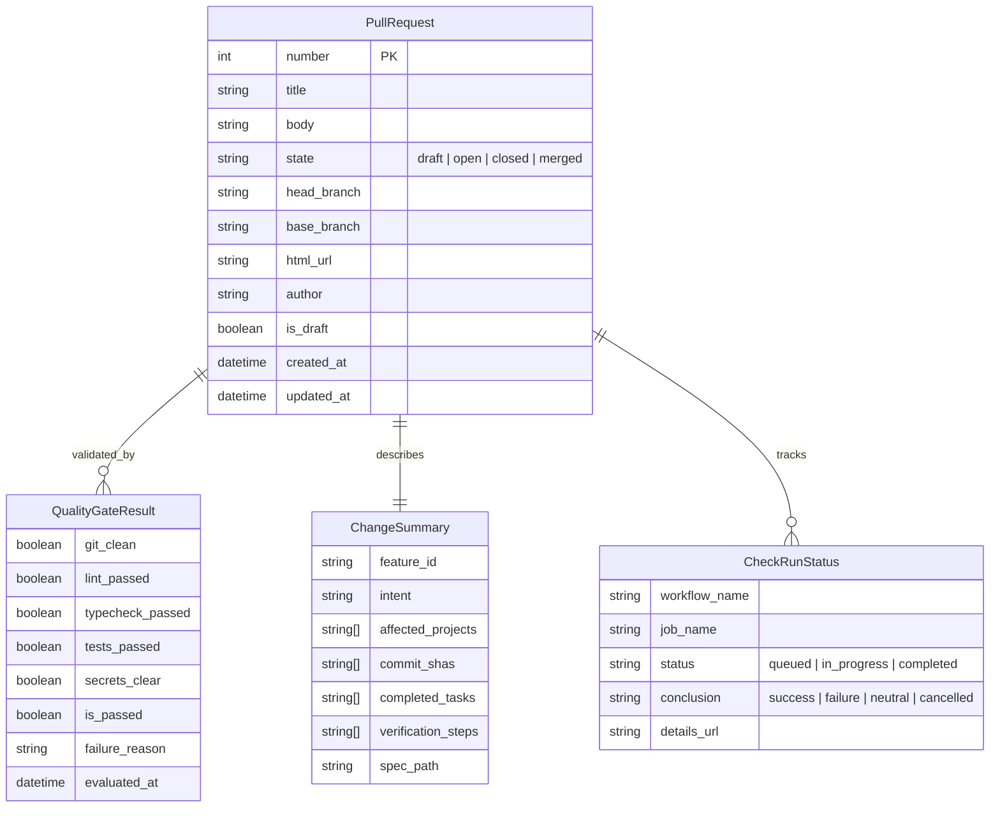

# Data Model: Post-Implementation PR Management Skills

**Feature**: `007-manage-pr-workflow`
**Date**: 2026-10-12
**Status**: Completed

## Entity Relationship Overview



---

## Entities

### 1. PullRequest

Represents the remote GitHub Pull Request resource (and Merge Request alias).

| Field | Type | Required | Description |
| :--- | :--- | :--- | :--- |
| `number` | Integer | Yes | Unique GitHub Pull Request number (e.g., `42`) |
| `title` | String | Yes | Concise conventional summary (e.g., `feat(pr): implement post-implementation PR skills`) |
| `body` | String (Markdown) | Yes | Structured PR description adhering to Constitution Principle I |
| `state` | Enum | Yes | `draft`, `open`, `closed`, `merged` |
| `head_branch` | String | Yes | Origin feature branch (e.g., `007-manage-pr-workflow`) |
| `base_branch` | String | Yes | Target branch for integration (defaults to `main`) |
| `html_url` | String (URL) | Yes | Clickable web link to GitHub Pull Request |
| `author` | String | Yes | GitHub username of the author or bot |
| `is_draft` | Boolean | Yes | Indicates whether PR is in Draft state |
| `created_at` | Timestamp | Yes | ISO 8601 creation timestamp |
| `updated_at` | Timestamp | Yes | ISO 8601 last update timestamp |

#### Lifecycle State Transitions:

```text
[Local Branch] 
   │
   ▼
[Unpublished] ──(create --draft)──► [Draft PR] ──(publish / ready)──► [Open PR]
   │                                     │                                │
   │                                     ▼                                ▼
   └──(create --ready)──────────────────► [Open PR] ──(merge)──────► [Merged]
                                              │
                                              └──(close)──────────► [Closed]
```

---

### 2. ChangeSummary

Synthesizes local repository changes, completed specification tasks, and touched monorepo projects for the PR description.

| Field | Type | Required | Description |
| :--- | :--- | :--- | :--- |
| `feature_id` | String | Yes | Active feature directory / ID (e.g., `007-manage-pr-workflow`) |
| `intent` | String | Yes | Motivation and business value extracted from feature specification |
| `affected_projects` | Array[String] | Yes | Monorepo applications/libraries touched (e.g., `["apps/idea-collector", "scripts"]`) |
| `commit_shas` | Array[String] | Yes | Git commit hashes introduced on the feature branch relative to base |
| `completed_tasks` | Array[String] | Yes | Completed checklist items from `tasks.md` |
| `verification_steps` | Array[String] | Yes | Step-by-step instructions for human/agent reviewers to verify changes |
| `spec_path` | String | Yes | Relative path to `spec.md` (e.g., `specs/007-manage-pr-workflow/spec.md`) |

---

### 3. QualityGateResult

Encapsulates the pre-flight verification outcomes executed locally prior to opening or modifying a PR.

| Field | Type | Required | Description |
| :--- | :--- | :--- | :--- |
| `git_clean` | Boolean | Yes | `true` if working directory has no uncommitted or untracked changes |
| `lint_passed` | Boolean | Yes | `true` if Nx / project linters pass with zero errors |
| `typecheck_passed` | Boolean | Yes | `true` if TypeScript / Go typechecks succeed |
| `tests_passed` | Boolean | Yes | `true` if baseline test suites pass across affected projects |
| `secrets_clear` | Boolean | Yes | `true` if no credentials or private keys are detected in diff |
| `is_passed` | Boolean | Yes | Composite boolean (`true` only if all above gates are `true`) |
| `failure_reason` | String | No | Detailed diagnosis if any gate fails |
| `evaluated_at` | Timestamp | Yes | ISO 8601 evaluation timestamp |

---

### 4. CheckRunStatus

Represents remote GitHub Actions CI workflow execution states associated with the Pull Request.

| Field | Type | Required | Description |
| :--- | :--- | :--- | :--- |
| `workflow_name` | String | Yes | Name of GitHub Actions workflow (e.g., `on_pull_request.yml`) |
| `job_name` | String | Yes | Job identifier within workflow (e.g., `lint-and-test`) |
| `status` | Enum | Yes | `queued`, `in_progress`, `completed` |
| `conclusion` | Enum | No | `success`, `failure`, `neutral`, `cancelled`, `timed_out` |
| `details_url` | String (URL) | No | Direct URL to GitHub Actions run logs |

---

## Validation & Business Rules

1. **Pre-flight Gate Rule**: A PR MUST NOT be created or updated if `QualityGateResult.is_passed` is `false`.
2. **Draft Default Rule**: If `--ready` is omitted during initial creation, `PullRequest.is_draft` MUST default to `true`.
3. **Idempotent Update Rule**: If `PullRequest` already exists for `head_branch`, invoking create MUST update the existing PR rather than creating a duplicate.
4. **Constitution Compliance Rule**: `PullRequest.body` MUST contain non-empty `Intent`, `Scope`, and `Verification Steps` sections.
