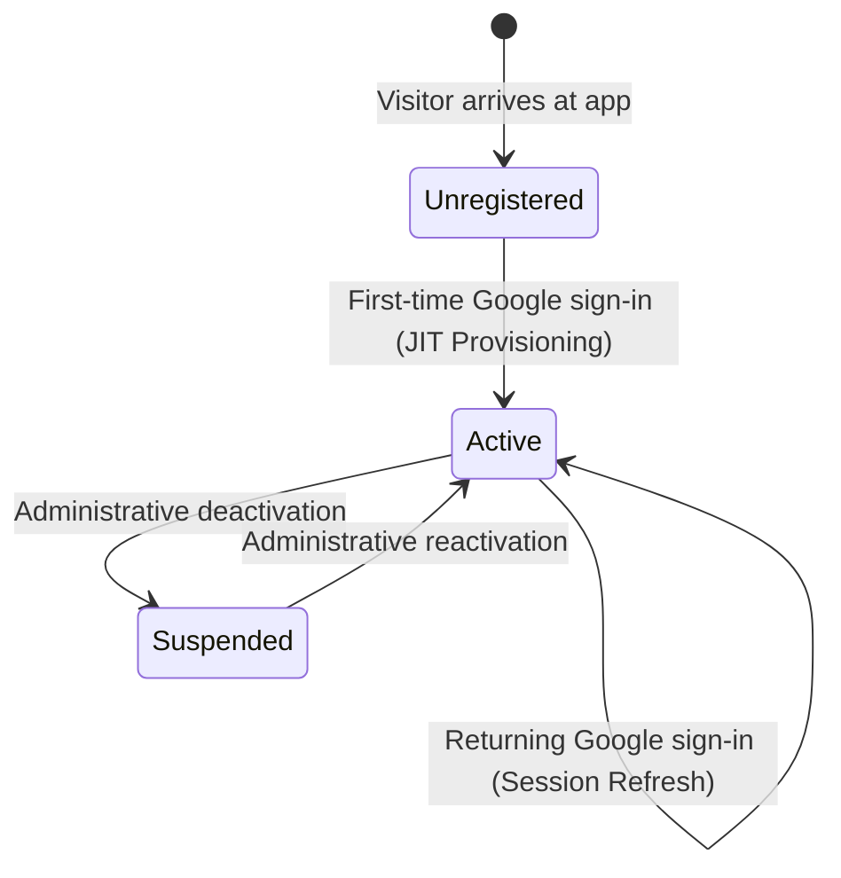
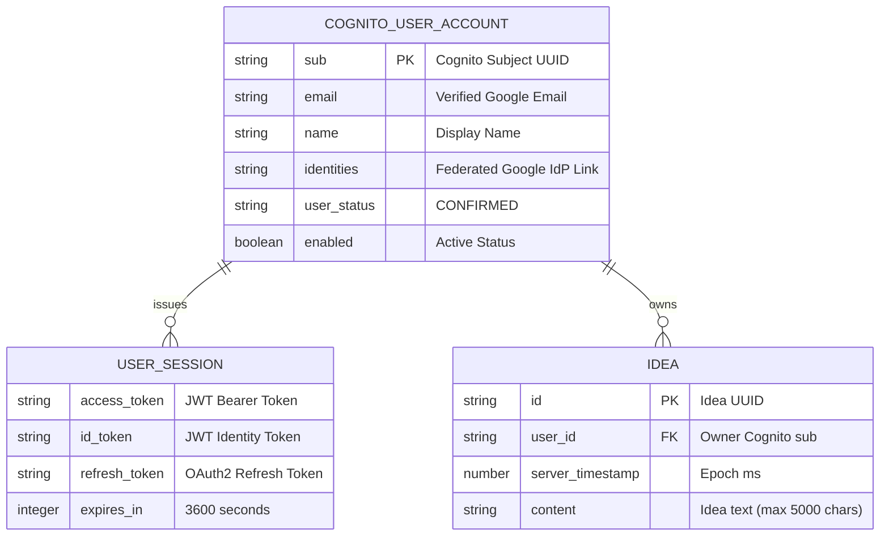

# Data Model: Public User Registration & AWS Cognito Authentication

## Overview

This document specifies the data model for user identity, sessions, and user-isolated idea data under the AWS Cognito User Pool and DynamoDB architecture.

---

## 1. Key Entities

### Entity: User Account (AWS Cognito User Pool)

The authoritative identity store for all registered individuals. Accounts are provisioned automatically (Just-In-Time) when a user authenticates via Google for the first time.

| Field Name | Type | Source / Format | Description |
| :--- | :--- | :--- | :--- |
| `sub` | String (UUID) | Cognito Generated | Unique, immutable subject identifier for the user. Primary key for user identity. |
| `email` | String | Google Claim (`email`) | Verified email address. Auto-verified upon Google federation. |
| `name` | String | Google Claim (`name`) | Display name / full name extracted from Google profile. |
| `identities` | JSON Array | Cognito Internal | Metadata linking federated provider (`Google`) and provider subject ID. |
| `user_status` | String | Cognito Status | Account status (`EXTERNAL_PROVIDER` / `CONFIRMED`). |
| `enabled` | Boolean | System Flag | Whether the user account is active (`true`) or administratively suspended (`false`). |
| `created_at` | Timestamp | ISO 8601 | Timestamp of first registration in Cognito User Pool. |
| `last_modified_at` | Timestamp | ISO 8601 | Timestamp of latest account update or token refresh. |

#### Validation Rules
- `email`: Must be a valid email format, verified by Google (`email_verified = true`).
- `sub`: Must be a non-empty, unique UUID.
- Unverified Google accounts are rejected before account creation.

#### Lifecycle & State Transitions



---

### Entity: User Session (Cognito JWT Tokens)

Represents an active, authenticated session. Tokens are issued by the Cognito User Pool upon successful OAuth2 code exchange or refresh.

| Field Name | Type | Storage | Description |
| :--- | :--- | :--- | :--- |
| `id_token` | JWT String | Client Storage (Memory/Session) | Identity assertion containing `sub`, `email`, `name`, `exp`, and `iss`. |
| `access_token` | JWT String | Client Storage (Memory/Session) | Authorization Bearer token sent in `Authorization: Bearer <token>` header. |
| `refresh_token` | String | Client Storage (Secure Storage) | Long-lived token used to obtain fresh access/ID tokens without re-prompting. |
| `expires_in` | Integer | Client Metadata | Token validity window in seconds (default 3600 seconds / 1 hour). |
| `token_type` | String | Fixed | Always `"Bearer"`. |

#### Token Claims (Access / ID Token)

```json
{
  "sub": "b2f6b4a1-1234-4567-89ab-cdef01234567",
  "email_verified": true,
  "iss": "https://cognito-idp.us-east-1.amazonaws.com/us-east-1_ExamplePoolId",
  "cognito:username": "Google_102938475610293847561",
  "email": "user@example.com",
  "name": "Jane Doe",
  "exp": 1729000000,
  "iat": 1728996400
}
```

---

### Entity: Idea (AWS DynamoDB `IdeaCollector_Ideas`)

Represents an idea authored by an authenticated user. Persisted in DynamoDB and partitioned by the owner's Cognito user identifier (`sub`).

| Field Name | DynamoDB Attribute | Type | Description |
| :--- | :--- | :--- | :--- |
| `id` | `id` (HASH) | String (UUID v4) | Unique idea identifier. |
| `user_id` | `user_id` (GSI HASH) | String (UUID / `sub`) | Owner identifier corresponding to the Cognito user's `sub`. |
| `server_timestamp` | `server_timestamp` (GSI RANGE) | Number (Epoch ms) | Timestamp recorded by the backend upon persistence. |
| `client_timestamp` | `client_timestamp` | Number (Epoch ms) | Timestamp recorded by the client at form submission. |
| `content` | `content` | String | The idea content text (1 to 5,000 characters). |

#### DynamoDB Table Configuration
- **Table Name**: `IdeaCollector_Ideas`
- **Primary Hash Key**: `id` (String)
- **Global Secondary Index**: `UserIdeasIndex`
  - **Index Hash Key**: `user_id` (String)
  - **Index Range Key**: `server_timestamp` (Number)
  - **Projection**: `ALL`

#### Validation Rules
- `content`: Length between 1 and 5,000 characters; cannot consist solely of whitespace.
- `user_id`: Must match the authenticated caller's Cognito `sub` extracted by the API Gateway authorizer.

---

## 2. Decommissioned Entities

In accordance with feature requirements and clarification decisions:
- **`Invitation`**: Decommissioned. All invitation storage and validation logic are removed.
- **`IdeaCollector_Users` (DynamoDB Table)**: Decommissioned. User profiles are now centrally managed by AWS Cognito User Pool.
- **`IdeaCollector_Sessions` (DynamoDB Table)**: Decommissioned. Sessions are managed via standard Cognito JWT tokens with 1-hour expiration.

---

## 3. Entity Relationships


