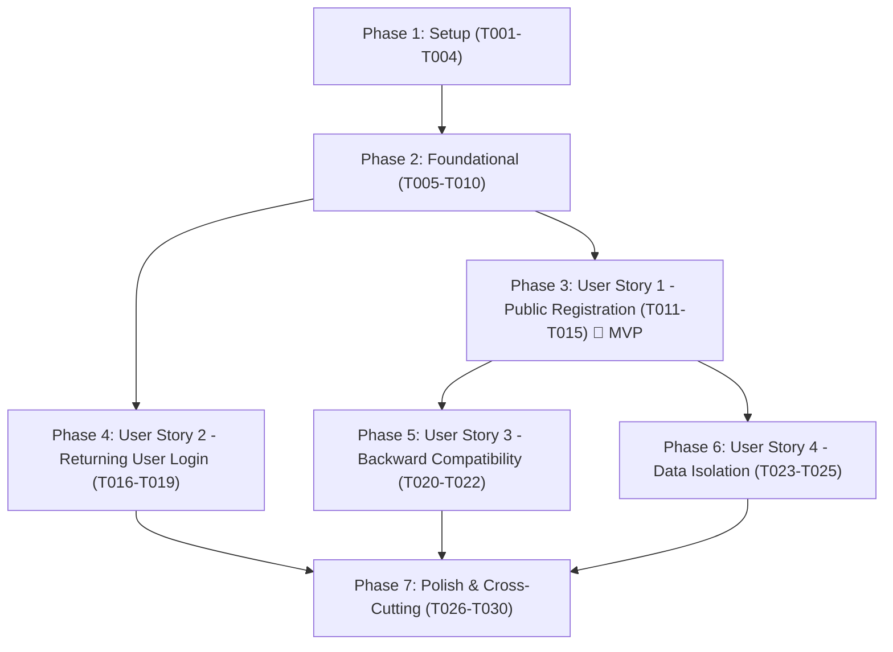

# Implementation Tasks: Public User Registration & Google Authentication with AWS Cognito

**Feature Branch**: `008-public-registration-google-auth` | **Spec**: [spec.md](file:///home/loctran/coding/myspace/specs/008-public-registration-google-auth/spec.md) | **Plan**: [plan.md](file:///home/loctran/coding/myspace/specs/008-public-registration-google-auth/plan.md)

---

## Phase 1: Setup (Shared Infrastructure)

**Purpose**: Configure AWS Cognito User Pool, Google Social Identity Provider, User Pool Client, and API Gateway JWT Authorizer via Terraform.

- [X] T001 [P] Configure Terraform variables and outputs for Cognito User Pool in `apps/idea-collector/infra/variables.tf` and `apps/idea-collector/infra/outputs.tf`
- [X] T002 Configure AWS Cognito User Pool, Google Identity Provider, User Pool Client with PKCE, and User Pool Domain in `apps/idea-collector/infra/main.tf`
- [X] T003 Configure AWS API Gateway HTTP API v2 native JWT Authorizer attached to the Cognito User Pool issuer in `apps/idea-collector/infra/main.tf`
- [X] T004 [P] Configure frontend Cognito environment variables (`VITE_COGNITO_DOMAIN`, `VITE_COGNITO_CLIENT_ID`, `VITE_COGNITO_REDIRECT_URI`) in `apps/idea-collector/frontend/.env.example` and `apps/idea-collector/frontend/.env`

---

## Phase 2: Foundational (Blocking Prerequisites)

**Purpose**: Decommission the legacy invitation subsystem and implement core PKCE and token management utilities.

**⚠️ CRITICAL**: Must complete before user story implementation begins.

- [X] T005 [P] Decommission and remove the invitation handler file `apps/idea-collector/backend/handlers/invitations.go` and remove the `POST /api/invitations` route from `apps/idea-collector/infra/main.tf`
- [X] T006 [P] Remove invitation request and response structs from `apps/idea-collector/backend/models/models.go`
- [X] T007 Refactor Lambda entry routing in `apps/idea-collector/backend/main.go` to extract authenticated caller claims (`sub`, `email`, `name`) from API Gateway JWT context (`req.RequestContext.Authorizer.JWT.Claims`)
- [X] T008 [P] Decommission and delete the invitation form component `apps/idea-collector/frontend/src/components/InviteForm.tsx` and remove invitation API methods from `apps/idea-collector/frontend/src/services/api.ts`
- [X] T009 [P] Implement OAuth2 PKCE utility functions (generating random `code_verifier` and SHA-256 `code_challenge`) using Web Crypto API in `apps/idea-collector/frontend/src/services/pkce.ts`
- [X] T010 Implement Cognito OAuth2 token exchange (`/oauth2/token`), token storage, and session refresh logic in `apps/idea-collector/frontend/src/services/auth.ts`

**Checkpoint**: Core Cognito infrastructure and frontend token services in place; legacy invitation code eliminated. User stories can now proceed.

---

## Phase 3: User Story 1 - Public Self-Registration via Google Sign-In (Priority: P1) 🎯 MVP

**Goal**: An uninvited visitor arrives at the entry screen, sees a prominent "Sign in with Google" button, completes authentication via Cognito, gets provisioned automatically in the Cognito User Pool, and lands directly in an initialized, private workspace.

**Independent Test**: Navigate to the application in a clean browser session with an uninvited Google account, click "Sign in with Google", authenticate, and verify that the user lands immediately in the workspace with empty state and user details populated from the token.

- [X] T011 [P] [US1] Update `apps/idea-collector/frontend/src/components/AuthPrompt.tsx` with a prominent "Sign in with Google" button that initiates direct PKCE authorization redirect to Cognito with `identity_provider=Google`
- [X] T012 [P] [US1] Update `apps/idea-collector/frontend/src/components/Header.tsx` to display the user's name and email extracted from the Cognito ID token claims without displaying invitation controls
- [X] T013 [US1] Implement OAuth2 authorization code callback handling in `apps/idea-collector/frontend/src/App.tsx` ensuring direct entry to the workspace without intermediate onboarding forms
- [X] T014 [US1] Update user profile endpoint handler `HandleGetMe` in `apps/idea-collector/backend/handlers/auth.go` to return `user_id` (`sub`), `email`, and `name` from the validated JWT authorizer claims
- [X] T015 [US1] Add a welcoming empty-state display in `apps/idea-collector/frontend/src/components/IdeaList.tsx` for newly registered users guiding them to submit their first idea

**Checkpoint**: User Story 1 MVP fully functional and testable independently. Any visitor can register and enter their workspace without an invitation.

---

## Phase 4: User Story 2 - Returning User Login via Google Sign-In (Priority: P1)

**Goal**: Existing registered users log in using "Sign in with Google", resume their authenticated session, view previously saved ideas, and log out cleanly.

**Independent Test**: Log in with an existing registered account, author an idea, log out, log back in with Google, and verify the idea is displayed and active session restored.

- [X] T016 [P] [US2] Implement automatic token refresh using Cognito `refresh_token` before 1-hour expiration in `apps/idea-collector/frontend/src/services/auth.ts`
- [X] T017 [P] [US2] Implement user logout action in `apps/idea-collector/frontend/src/components/Header.tsx` and `apps/idea-collector/frontend/src/services/auth.ts` that clears local tokens and returns the user to the public landing screen
- [X] T018 [US2] Update API client in `apps/idea-collector/frontend/src/services/api.ts` to attach `Authorization: Bearer <access_token>` to all idea requests and catch HTTP 401 responses
- [X] T019 [US2] Update `apps/idea-collector/frontend/src/components/SessionExpiredModal.tsx` to prompt Google re-authentication when a 1-hour session expires while preserving unsaved draft text in `IdeaForm.tsx`

**Checkpoint**: User Story 2 complete. Session lifecycle, token renewal, returning user login, and clean logout are operational.

---

## Phase 5: User Story 3 - Backward Compatibility for Invited and Pre-Existing Accounts (Priority: P2)

**Goal**: Users whose accounts were provisioned under earlier invite-only milestones can sign in via Google and retain full access to their existing ideas with zero duplication or data loss.

**Independent Test**: Authenticate with an existing invited account from milestone 002 and verify that previously submitted ideas are displayed and accessible.

- [X] T020 [P] [US3] Implement identity lookup mapping in `apps/idea-collector/backend/repository/dynamo.go` to resolve ideas by either Cognito `sub` or historical verified email identifier
- [X] T021 [US3] Update `apps/idea-collector/backend/handlers/ideas.go` to query `UserIdeasIndex` using the resolved user identifier so existing ideas are returned
- [X] T022 [US3] Add unit test cases in `apps/idea-collector/backend/handlers/ideas_test.go` verifying that pre-existing accounts retrieve historical ideas without error

**Checkpoint**: User Story 3 complete. Historical accounts and their associated ideas remain fully accessible.

---

## Phase 6: User Story 4 - Data Isolation and Privacy for Self-Registered Users (Priority: P2)

**Goal**: Ensure strict multi-tenant isolation between self-registered users, preventing cross-user idea exposure and blocking unauthenticated requests.

**Independent Test**: Register two distinct accounts (User A and User B), submit ideas under each, verify neither user can view or query the other's content, and verify unauthenticated requests receive HTTP 401.

- [X] T023 [P] [US4] Enforce user ownership isolation and validation in `apps/idea-collector/backend/repository/dynamo.go`, validating that `content` length is between 1 and 5,000 characters (cannot consist solely of whitespace) and `user_id` strictly matches the caller's Cognito `sub`
- [X] T024 [P] [US4] Enforce API Gateway JWT authorizer on `POST /api/ideas` and `GET /api/ideas` in `apps/idea-collector/infra/main.tf` to block unauthenticated requests at the edge with HTTP 401
- [X] T025 [US4] Add cross-tenant authorization tests in `apps/idea-collector/backend/handlers/ideas_test.go` verifying that attempts to access or query ideas owned by another `user_id` are blocked with zero data leakage

**Checkpoint**: User Story 4 complete. Multi-tenant privacy and data isolation guarantees verified across all access layers.

---

## Phase 7: Polish & Cross-Cutting Concerns

**Purpose**: End-to-end verification, quality validation, test execution, and documentation updates.

- [X] T026 [P] Execute end-to-end verification scenarios 1 through 6 per `specs/008-public-registration-google-auth/quickstart.md`
- [X] T027 [P] Run backend unit and contract tests via `go test -v -race ./...` in `apps/idea-collector/backend`
- [X] T028 [P] Run frontend typecheck and linting via `pnpm build && pnpm lint` in `apps/idea-collector/frontend`
- [X] T029 Run Terraform validation via `terraform validate` in `apps/idea-collector/infra`
- [X] T030 Update project architecture and configuration documentation in `apps/idea-collector/README.md` reflecting AWS Cognito User Pool integration and decommissioned invitation endpoints

---

## Dependencies & Execution Order

### Phase Dependencies
- **Phase 1 (Setup)**: Can start immediately (infrastructure & env definitions).
- **Phase 2 (Foundational)**: Depends on Phase 1; BLOCKS all user stories (removes legacy invitations, establishes PKCE & Cognito token services).
- **Phase 3 (User Story 1 - MVP)**: Depends on Phase 2; enables core self-registration flow.
- **Phase 4 (User Story 2)**: Depends on Phase 2 & US1 token services; enables session persistence & logout.
- **Phase 5 (User Story 3)**: Depends on Phase 3 backend handlers; preserves historical ideas.
- **Phase 6 (User Story 4)**: Depends on Phase 3 backend handlers; enforces multi-tenant boundary checks.
- **Phase 7 (Polish)**: Depends on all user stories; runs test suites, quickstart verification, and doc updates.

---

## Parallel Execution Opportunities

### Phase 1: Setup
- `T001` (variables/outputs) and `T004` (frontend env) can execute in parallel.

### Phase 2: Foundational
- `T005` (decommission backend invitation handler), `T006` (models cleanup), `T008` (remove frontend InviteForm), and `T009` (PKCE helper) can execute in parallel across different files.

### Phase 3: User Story 1
- `T011` (AuthPrompt Google button), `T012` (Header user display), and `T014` (auth.go GetMe handler) can execute in parallel.

### Phase 4: User Story 2
- `T016` (token refresh service) and `T017` (logout UI action) can execute in parallel.

### Phase 6: User Story 4
- `T023` (DynamoDB repository checks) and `T024` (API Gateway authorizer routes) can execute in parallel.

---

## Implementation Strategy

### MVP First (User Story 1 Only)
1. Complete Phase 1 (Setup) and Phase 2 (Foundational).
2. Complete Phase 3 (User Story 1).
3. **Validate MVP**: Test public self-registration via "Sign in with Google" in an incognito window.
4. Verify account is created in Cognito User Pool and user enters an empty workspace with no invitation required.

### Incremental Delivery
1. **Increment 1 (MVP)**: Open public self-registration via Google without invitation (US1).
2. **Increment 2**: Returning user session persistence, automatic token renewal, and clean logout (US2).
3. **Increment 3**: Backward compatibility preserving existing invited accounts and historical ideas (US3).
4. **Increment 4**: Hardened multi-tenant isolation and edge JWT validation (US4).
5. **Increment 5**: Complete quickstart verification, linting, test suites, and documentation (Polish).
